  

# Shanu Jha

I'm a software engineer in Pune. For seven years I've built the software that organisations run on: file storage, payments, citizen services and internal tools. I work mostly in TypeScript, React and Node.

## What I work on

- **Cloud file storage.** An internal platform over S3 with per-user storage quotas, background ZIP and move jobs, and folder-based sharing. Node, Redis, S3.
- **Civic and enterprise platforms.** Web and mobile systems for city governments and large organisations: citizen portals, admin dashboards, grievance handling, surveys, and payment and property-tax services. Most of this is private client work, so I describe it here without naming clients.
- **Desktop and personal tools.** I build small apps for problems I run into myself, like the ones below.

## Projects you can open

- [**heic-to-ddw**](https://github.com/shanujha/heic-to-ddw): turns macOS dynamic wallpapers (.heic) into WinDynamicDesktop themes (.ddw), in your browser and on your own machine.
- [**lifecalendar-desktop**](https://github.com/shanujha/lifecalendar-desktop): the life calendar, as a desktop app for Windows.
- [**google-calendar-chat**](https://github.com/shanujha/google-calendar-chat): an agent you can talk to about your Google Calendar.
- [**docker-aliases-bash**](https://github.com/shanujha/docker-aliases-bash): short aliases for Docker and Docker Compose commands.
- [**setup-starship-zoxide.sh**](https://github.com/shanujha/setup-starship-zoxide.sh): a script that sets up the Starship prompt and zoxide.

## Growth rings

One ring per year on GitHub. The thicker the ring, the more I shipped that year, private work included.

## Tools I use

The skyline and rings are generated from my GitHub data by [`scripts/build-visuals.mjs`](scripts/build-visuals.mjs) and refreshed weekly by a workflow. No third-party stats service involved.
